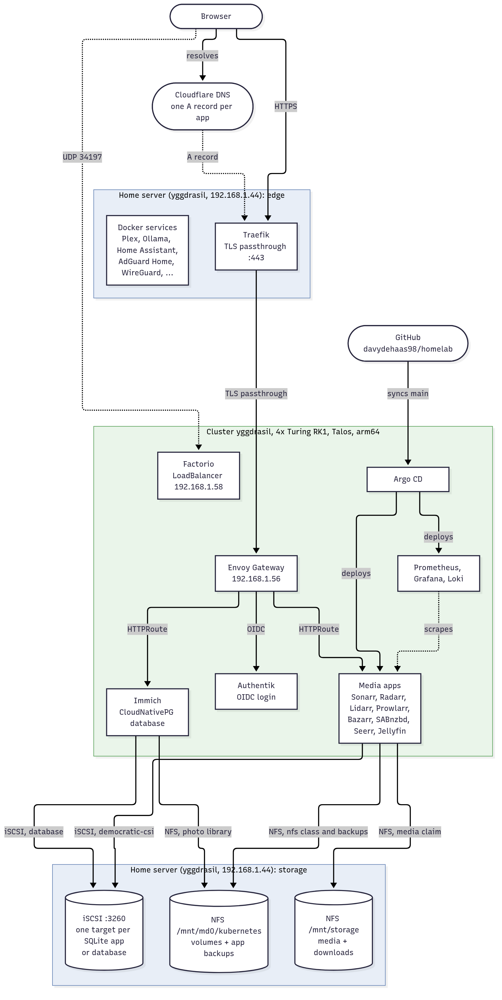
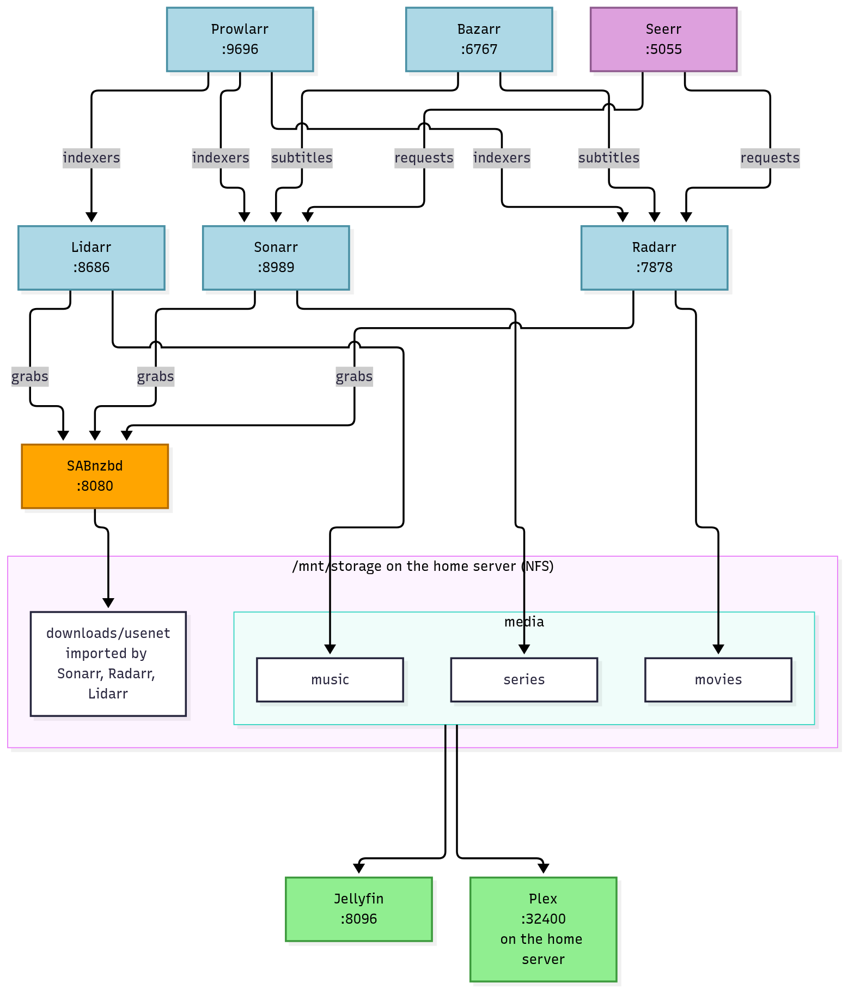
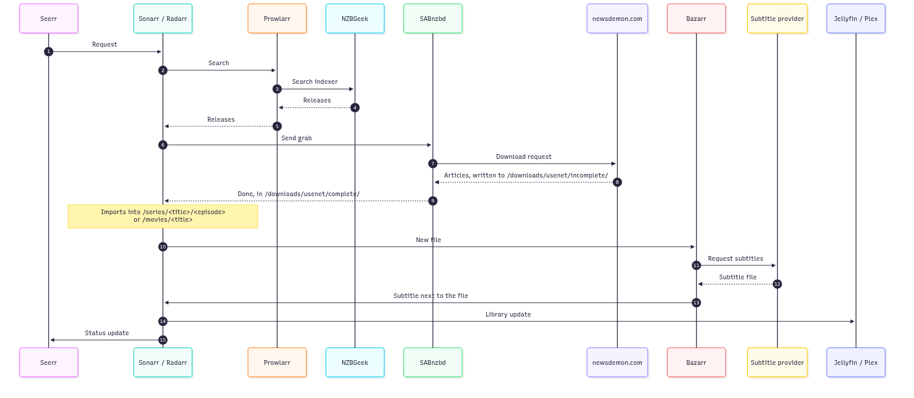

# Diagrams

Mermaid sources (`*.mmd`) rendered to PNGs with a white background, so they stay readable in dark mode.

## Architecture



## Media stack



## Request flow

Sonarr handles series and Radarr movies; the flow is the same.



## Rendering

Run from the repository root after changing a `.mmd` file:

```shell
for d in architecture media-stack request-flow; do
  podman run --rm -v "$PWD/docs/diagrams:/data" ghcr.io/mermaid-js/mermaid-cli/mermaid-cli \
    -p /data/puppeteer.json -i /data/$d.mmd -o /data/$d.png -b white -s 2
done
```
